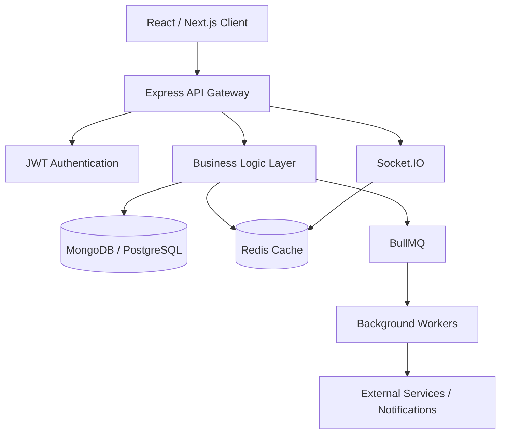

 

 

---

## About Me

I'm a **Full Stack Developer at MetConnect**, passionate about building scalable web applications and backend systems.

I primarily work with the MERN stack, focusing on backend engineering, API development, database optimization, background processing and real-time applications.

I'm also exploring **Generative AI, LLMs and Retrieval-Augmented Generation (RAG)** to build intelligent, production-ready applications.

- Building scalable backend applications and REST APIs.
- Working with Redis, BullMQ and background job processing.
- Exploring distributed systems and system design.
- Learning LLM integration, RAG and AI-powered workflows.
- Interested in backend engineering and AI-driven products.

| Profile | Details |
|---|---|
| Current Role | Full Stack Developer |
| Company | MetConnect |
| Primary Stack | MERN |
| Main Interest | Backend Engineering |
| Exploring | GenAI, LLMs, RAG, System Design |
| Open To | Collaboration and Development Projects |

---

## Tech Stack & Tools

### Frontend Development

### Backend Development

### Database & Message Queues

### DevOps & Development Tools

### AI & Generative AI

---

## Featured Projects

<table>
<tr>
<td width="50%" valign="top">

### [Prompt Optimizer](https://github.com/Rakeshchourasia/Prompt-Optimizer)

AI-assisted application for refining and managing prompts.

**Technologies:** JavaScript, GenAI

</td>
<td width="50%" valign="top">

### [BullMQ · Redis · GraphQL](https://github.com/Rakeshchourasia/Bullmq-redis-graphql)

Queue-driven backend application integrating background jobs, Redis and GraphQL APIs.

**Technologies:** Node.js, BullMQ, Redis, GraphQL

</td>
</tr>
<tr>
<td width="50%" valign="top">

### [Notes Manager AI](https://github.com/Rakeshchourasia/Notes-manager-ai)

Notes management application with AI-powered features.

**Technologies:** JavaScript, GenAI

</td>
<td width="50%" valign="top">

### [Eruvaka Spices Hub](https://github.com/Rakeshchourasia/Eruvaka-Spices-hub)

Web application developed for a spices business.

**Technologies:** JavaScript

</td>
</tr>
<tr>
<td width="50%" valign="top">

### [Movie Recommendation System](https://github.com/Rakeshchourasia/movie-recommendation-system)

Machine learning-based movie recommendation using similarity.

**Technologies:** Machine Learning

</td>
<td width="50%" valign="top">

### [Personal Portfolio](https://github.com/Rakeshchourasia/Myportfolio)

Personal developer portfolio built with React and Vite.

**Technologies:** React, Vite

[View Live Portfolio](https://rakeshchourasia-portfolio.vercel.app/)

</td>
</tr>
</table>

**[Explore All My Repositories →](https://github.com/Rakeshchourasia?tab=repositories)**

---

## Backend Architecture

I enjoy designing backend systems where business logic, background processing, caching and real-time communication work independently.

**Architecture interests:**
- Modular backend architecture
- REST API design and authentication
- Redis caching and pub/sub
- Asynchronous processing with BullMQ
- Database optimization
- Distributed systems and scalability

---

## GitHub Statistics

### Overall GitHub Stats

### Most Used Languages

### Contribution Activity

---

## Connect With Me

I'm always interested in discussing backend engineering, MERN development, system architecture and Generative AI.

<a href="https://rakeshchourasia-portfolio.vercel.app/">Portfolio</a> ·
<a href="https://linkedin.com/in/rakesh-chourasia-3a4b3825b">LinkedIn</a> ·
<a href="https://github.com/Rakeshchourasia">GitHub</a> ·
<a href="https://www.instagram.com/rakeshchourasia22/">Instagram</a> ·
<a href="https://www.facebook.com/rakesh.chourasia.52459">Facebook</a>

  

**Thanks for visiting my profile!**

