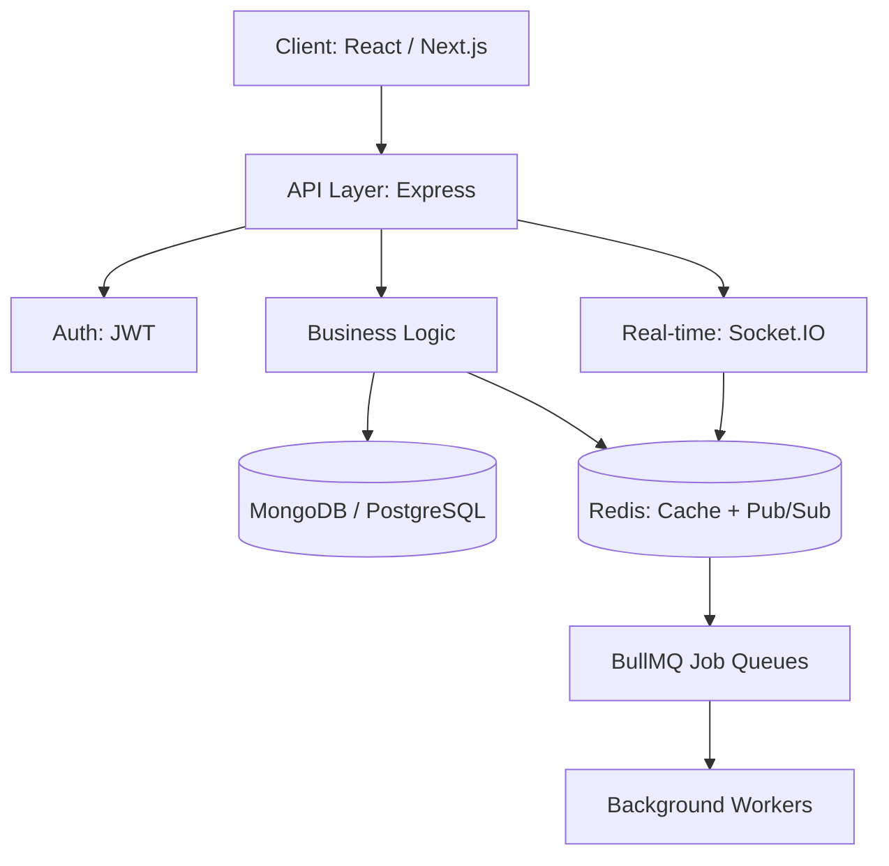

 

---

## About

I'm a **Full Stack Developer** at **[MetConnect](https://github.com/MetConnect)** who builds web applications on the MERN stack and enjoys the backend side most: queues, caching, real-time messaging and API design. I'm also exploring **Generative AI** and how to embed it into production products in a practical way.

| | |
|---|---|
| **Role** | Full Stack Developer (MERN) |
| **Company** | MetConnect |
| **Focus** | Backend architecture, job queues, real-time systems, GenAI integration |
| **Currently exploring** | System design, distributed architecture, AI-assisted workflows |
| **Open to** | Collaboration, MERN / backend / GenAI projects |

---

## Tech Stack

| Area | Technologies |
|---|---|
| **Frontend** |        |
| **Backend** |      |
| **Data & Queues** |     |
| **DevOps & Tools** |       |
| **AI** |   |

---

## Featured Projects

<table>
<tr>
<td width="50%" valign="top">

### [Prompt Optimizer](https://github.com/Rakeshchourasia/Prompt-Optimizer)
AI-assisted tool for refining and managing prompts.

`JavaScript` `GenAI`

</td>
<td width="50%" valign="top">

### [BullMQ · Redis · GraphQL](https://github.com/Rakeshchourasia/Bullmq-redis-graphql)
Queue-driven backend combining BullMQ job processing, Redis and a GraphQL API.

`JavaScript` `BullMQ` `Redis` `GraphQL`

</td>
</tr>
<tr>
<td width="50%" valign="top">

### [Notes Manager AI](https://github.com/Rakeshchourasia/Notes-manager-ai)
Notes application with AI-powered features.

`JavaScript` `GenAI`

</td>
<td width="50%" valign="top">

### [Eruvaka Spices Hub](https://github.com/Rakeshchourasia/Eruvaka-Spices-hub)
Web platform for a spices business.

`JavaScript`

</td>
</tr>
<tr>
<td width="50%" valign="top">

### [Movie Recommendation System](https://github.com/Rakeshchourasia/movie-recommendation-system)
Recommendation engine that suggests movies based on similarity.

`Machine Learning`

</td>
<td width="50%" valign="top">

### [Portfolio](https://github.com/Rakeshchourasia/Myportfolio)
Personal portfolio built with React and Vite, deployed on Vercel.

`React` `Vite` · [Live site](https://rakeshchourasia-portfolio.vercel.app/)

</td>
</tr>
</table>

More work is available on my [repositories page](https://github.com/Rakeshchourasia?tab=repositories).

---

## Architecture Focus

How I like to structure backend systems: request/response logic stays separate from background processing, with Redis as the backbone for caching, pub/sub and job queues.

---

## GitHub Stats

---

## Connect

I'm happy to talk about MERN development, backend architecture or GenAI integration.

[Portfolio](https://rakeshchourasia-portfolio.vercel.app/) · [LinkedIn](https://linkedin.com/in/rakesh-chourasia-3a4b3825b) · [Instagram](https://www.instagram.com/rakeshchourasia22/) · [Facebook](https://www.facebook.com/rakesh.chourasia.52459)

